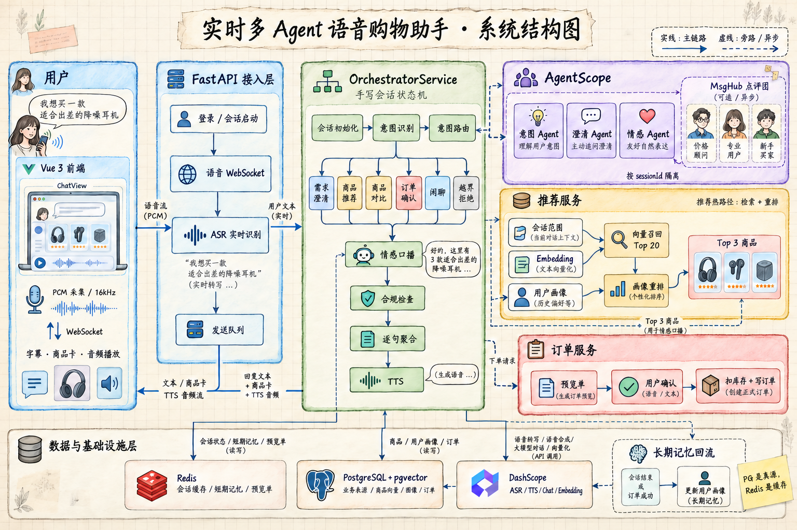
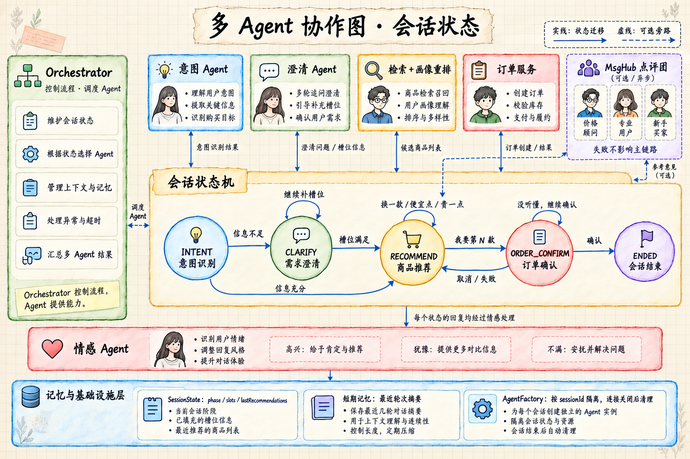
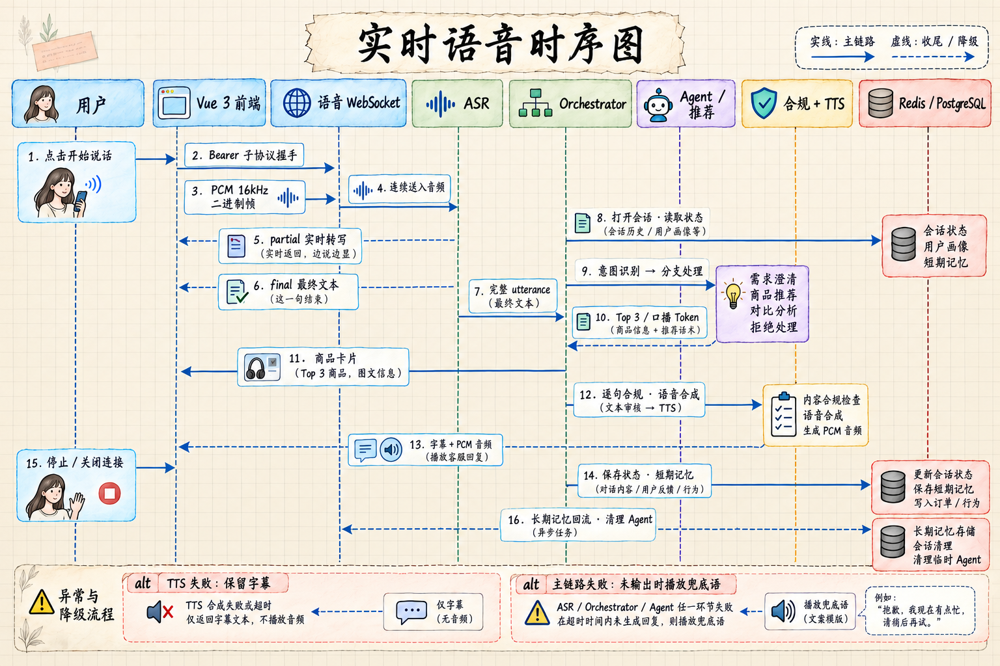
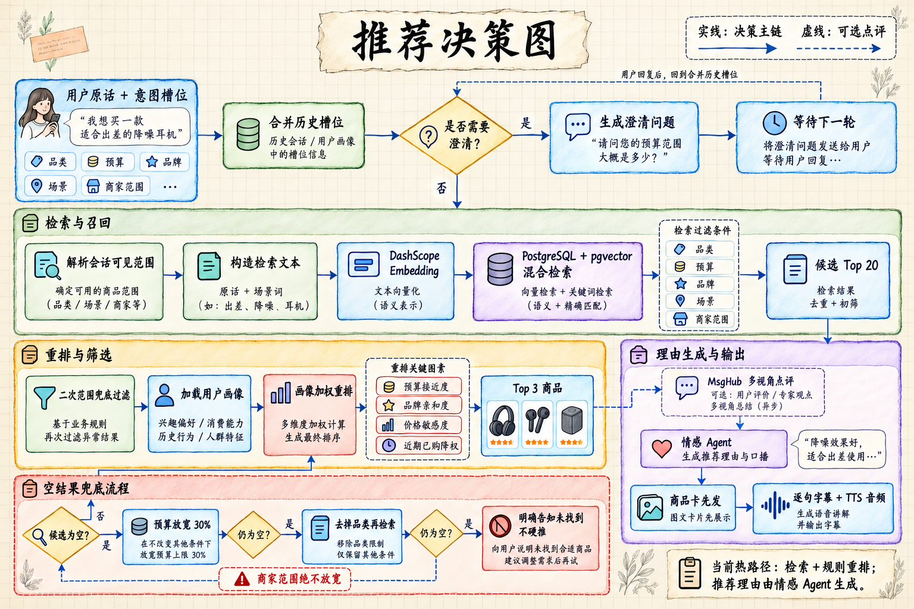
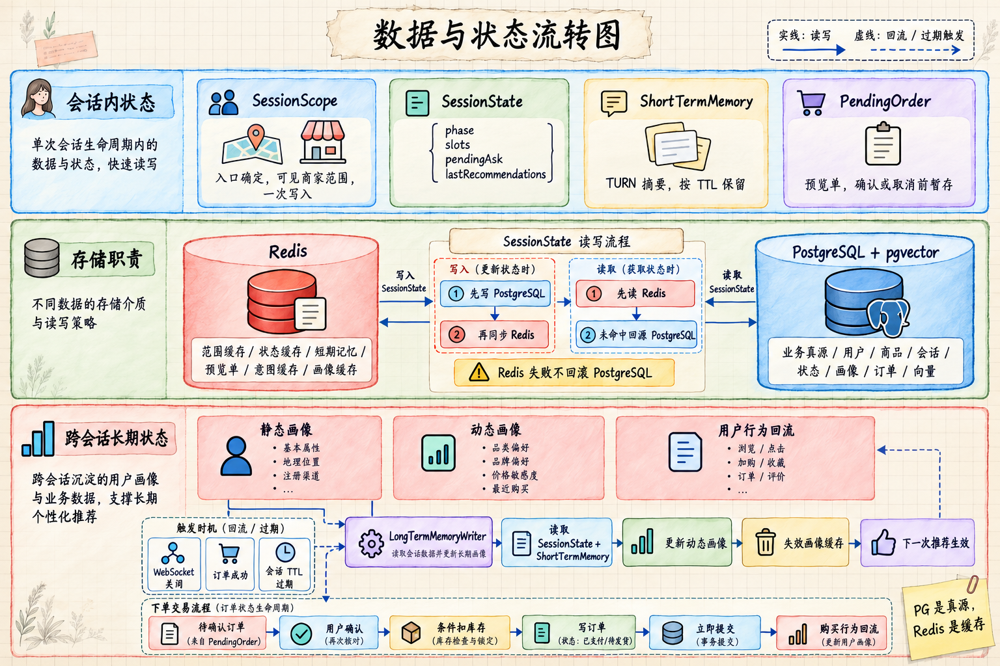

# Voice Shopping Agent

> 基于 FastAPI、AgentScope 与 DashScope 构建的多 Agent 实时语音购物助手。

用户可以直接通过麦克风描述购物需求，系统完成实时语音识别、意图与槽位提取、缺失信息追问、商品召回与画像重排，并以字幕和流式语音返回推荐结果。项目采用“无模型 Orchestrator + Worker Agent”的中心化编排方式：大模型负责理解与表达，检索、权限、订单和合规等确定性逻辑由 Service 层控制。

**关键词：** Python 3.12 · FastAPI · AgentScope · DashScope · PostgreSQL · pgvector · Redis · WebSocket · Vue 3

| 项目能力 | 当前实现 |
| --- | --- |
| 多 Agent | 7 个角色：3 个默认热路径、1 个回滚资产、3 个可选点评角色 |
| 实时语音 | WebSocket + 流式 ASR + 逐句 TTS |
| 推荐链路 | 向量召回 Top 20 + 用户画像重排 + Top 3 输出 |
| 会话状态 | Redis 短期记忆 + PostgreSQL 长期画像 + Agent 内部记忆 |
| 工程质量 | 1249 passed / 7 skipped；Ruff 零告警 |
| 前端 | Vue 3 + TypeScript + Vite，可独立使用后端测试页 |

## 项目价值

传统的单 Agent 导购容易把意图判断、商品查询、推荐生成和订单操作混在同一条 Prompt 中，出现流程跳步、上下文污染、工具越权和故障难定位等问题。本项目将链路拆分为可验证的职责边界：

- **模型负责理解和表达**：意图分类、自然追问、推荐理由与口语化回复。
- **代码负责流程控制**：状态机决定下一步，Agent 不自行选择业务流程。
- **Service 负责确定性业务**：商品检索、用户画像、权限范围、订单与合规不交给模型决策。
- **旁路能力允许失败**：多视角点评团异常时降级为空，不影响主推荐链路。

用户说一句“想买双 500 元以内的跑鞋，平时跑 5 公里”，系统会完成：

```text
语音输入 → ASR 断句 → 意图识别与槽位抽取 → 缺失信息判断
        → 商家范围过滤 → 向量召回 → 用户画像重排 → Top 3
        → 推荐理由与情感口播 → 合规检查 → 字幕与逐句 TTS
```

## 核心工作

- 设计并实现 Orchestrator-Worker 多 Agent 架构，将意图、澄清和最终口播拆分为独立 Worker，并由无模型状态机统一编排。
- 打通浏览器音频采集、WebSocket PCM 上行、ASR 尾点触发、商品卡片下发、字幕和 TTS 音频流式返回的完整链路。
- 实现 pgvector 商品召回、用户画像重排、商家范围隔离，以及预算和品类的逐级降级检索策略。
- 设计 Agent 内部记忆、Redis 会话短期记忆和 PostgreSQL 长期画像三层状态体系，并设置差异化记忆水位。
- 将推荐理由生成与情感包装合并为一次主模型调用，通过确认词短路、意图缓存、闲聊模板、Embedding 缓存和 TTS 缓存控制调用成本。
- 为状态流转、权限边界、异常降级和架构约束编写自动化测试，确保旁路故障不影响主流程。

## 核心亮点

### 1. 可控的多 Agent 编排

主链路采用中心化编排。`OrchestratorService` 不持有模型句柄，只负责状态读取、意图分发、分支执行和结果收口；各 Agent 由 Service 封装，Agent 之间传递结构化结果而不是自由对话。

这种设计将“下一步做什么”留在可测试的代码中，避免模型跳过澄清、直接查库或执行高风险操作。

### 2. 流式语音交互

ASR 识别到完整语句后触发一次编排。推荐分支先下发商品卡片，再将 EmotionAgent 的 Token 流聚合为完整短句，按“该句字幕 → 该句音频”的顺序逐句推送，用户无需等待整段回答生成完成。

AgentScope 的 `ReActAgent` 没有直接暴露流式接口，项目通过消息队列接收 Agent 输出，并同时监听队列与 Agent Task，处理重复末帧、生产端异常和超时，避免消费者永久阻塞。

### 3. 检索与个性化重排

推荐决策由 Service 完成，而不是让 LLM 自由选品：

1. 根据用户原话和场景生成检索文本。
2. 在当前商家范围内通过 pgvector 召回 Top 20。
3. 结合长期用户画像进行加权重排。
4. 取 Top 3 交给 EmotionAgent 生成理由和口播。
5. 无结果时依次放宽预算和品类，但始终不放宽商家权限范围。

### 4. 三层记忆与成本治理

| 层次 | 存储 | 用途 |
| --- | --- | --- |
| Agent 内部记忆 | AgentScope `InMemoryMemory` | 单个 Agent 实例的调用上下文 |
| 会话短期记忆 | Redis | 最近对话摘要、上下文消解、会话情绪 |
| 跨会话长期记忆 | PostgreSQL | 用户静态画像与动态偏好 |

意图 Agent 每轮清空内部记忆，避免上一轮槽位污染当前判断；EmotionAgent 保留较长上下文以维持情绪连续性；后台巡检任务定期处理异常增长的记忆。

### 5. 可靠性与合规出口

- 模型解析失败时返回结构化兜底结果。
- 点评团、事件发布和 TTS 等旁路故障不拖垮主链路。
- 所有最终口播都在 TTS 前经过敏感词和绝对化用语检查。
- 商品卡片与模型口播解耦，口播失败时仍可展示确定性的推荐结果。
- 订单确认使用本地规则短路，避免模型误解“确认”“取消”等高风险表达。

## 系统架构



| 层次 | 关键模块 | 职责 |
| --- | --- | --- |
| 接入层 | `app/api/*`、`voice_ws.py` | HTTP / WebSocket、JWT、流式分片 |
| 编排层 | `OrchestratorService` | 状态机、意图分支、统一出口、合规兜底 |
| Agent 层 | `app/agent/*` | 意图、澄清、口播、回滚推荐和点评团角色 |
| 领域服务层 | `app/services/*` | 检索、重排、订单、范围隔离、成本控制 |
| 数据访问层 | `app/repositories/*`、`models/*` | PostgreSQL / Redis 读写 |
| 外部能力 | DashScope | LLM、Embedding、ASR、TTS |

## 多 Agent 设计



### Agent 角色

| Agent | 模型 | 职责 |
| --- | --- | --- |
| `intent_agent` | qwen-flash | 六类意图分类与槽位抽取 |
| `clarify_agent` | qwen-flash | 将缺失槽位包装成一句自然追问 |
| `emotion_agent` | qwen-max | 情绪适配、推荐理由和最终口播 |
| `recommend_agent` | qwen-max | 独立生成推荐理由 |
| `price_advisor` | qwen-plus | 价格、促销与替代款视角 |
| `pro_runner` | qwen-plus | 性能、保护与场景适配视角 |
| `beginner_buyer` | qwen-plus | 上手、穿搭与心理价位视角 |

### 两种协作方式

**主链路：Service 接力**

```text
Orchestrator
  → IntentService → IntentAgent → IntentResult
  → ClarifyService → ClarifyAgent → ClarifyResult（仅信息不足时）
  → RecommendOrchestrator → RecommendResult
  → EmotionService → EmotionAgent → EmotionResult
```

Agent 之间不直接对话，控制权始终在 Orchestrator。检索、画像、权限和订单数据由 Service 查询后以结构化数据提供给 Agent。

**可选旁路：MsgHub 点评团**

三个一次性 Agent 进入同一个 AgentScope `MsgHub`，按价格顾问、专业跑者、入门买家的顺序发言。Hub 自动把前一个角色的输出广播给其他角色，讨论纪要最终作为上下文交给 EmotionAgent。点评团默认关闭，任何异常都降级为空串。

### Agent 生命周期

- 主链路四个 Agent 按 `session_id` 创建并进入 LRU 缓存，同一会话复用、不同会话隔离。
- LRU 最多保存 1000 个活跃会话，连接关闭时主动清理对应 Agent 与内部记忆。
- 三个点评 Agent 每次讨论重新创建，用完释放，避免上一场讨论污染下一场。
- `recommend_agent` 会随会话 AgentSet 创建，但当前默认链路不调用模型。

## 核心交互流程

### 语音请求时序



1. 浏览器将 16 kHz PCM 音频通过 `/ws/voice` 上行。
2. ASR 持续返回中间结果，尾点到达后将完整语句交给 Orchestrator。
3. Orchestrator 幂等开启会话、读取状态并执行意图识别。
4. 状态机进入推荐、澄清、比较、订单、闲聊或越界分支。
5. 推荐分支先发送商品卡片，再逐句发送字幕和对应音频。
6. 最终结果写入短期记忆并保存会话状态。

### 推荐决策链路



```text
合并历史槽位与本轮槽位
        ↓
规则判断是否需要澄清
        ↓
固定当前会话商家范围
        ↓
读取用户画像 + 向量召回 Top 20
        ↓
无结果：预算放宽 30% → 丢弃品类 → 温和告知
        ↓
画像加权重排 → Top 3
        ↓
EmotionAgent 一次生成推荐理由与最终口播
```

### 数据与状态



会话阶段：

```text
INTENT → CLARIFY / RECOMMEND / ORDER_CONFIRM → ENDED
```

PostgreSQL 保存用户、商品、画像、会话和订单等持久化数据；Redis 保存会话状态、商家范围、短期记忆、待确认订单和各类缓存；AgentScope 内存仅保存当前 Agent 实例的调用上下文。

## 技术栈

| 分类 | 选型 |
| --- | --- |
| 语言与 Web | Python 3.12、FastAPI、Uvicorn、Pydantic v2 |
| Agent 框架 | AgentScope Python 1.0.21：`ReActAgent`、`InMemoryMemory`、`MsgHub` |
| 模型与语音 | qwen-max、qwen-flash、qwen-plus、text-embedding-v3、paraformer-realtime-v2、cosyvoice-v3-flash |
| 数据存储 | PostgreSQL 15+、pgvector、SQLAlchemy 2、asyncpg |
| 缓存与状态 | Redis |
| 认证 | PyJWT：HTTP Bearer / WebSocket 子协议 |
| 可观测性 | prometheus-client |
| 测试与规范 | pytest、pytest-asyncio、Ruff |
| 前端 | Vue 3、TypeScript、Vite、WebAudio API |

## 项目结构

```text
voice_agent/
├── backend/
│   ├── app/
│   │   ├── agent/              # Agent Builder、工厂与记忆策略
│   │   ├── api/                # HTTP 路由与 WebSocket 语音入口
│   │   ├── compliance/         # 敏感词与绝对化用语检查
│   │   ├── infrastructure/     # PostgreSQL、Redis、DashScope、日志与指标
│   │   ├── memory/             # 短期记忆、轮次摘要、长期记忆回流
│   │   ├── models/             # SQLAlchemy ORM 模型
│   │   ├── repositories/       # 数据访问层
│   │   ├── resources/          # Prompt、槽位规则、敏感词和测试页
│   │   ├── schemas/            # Pydantic 数据模型
│   │   ├── services/           # 编排、推荐、订单与成本控制
│   │   └── voice/              # ASR、TTS、断句和流式分片
│   ├── tests/                  # 单元测试与集成测试
│   ├── scripts/                # 结构检查、端到端验证与变异测试
│   ├── environment.yml
│   └── pyproject.toml
├── frontend/                   # Vue 3 前端
├── docs/                       # 系统架构图
├── doc/
│   ├── schema.sql              # 数据库 Schema、扩展和索引
│   └── data.sql                # 开发测试数据
└── README.md
```

## 快速启动

### 1. 准备依赖

- Python 3.12
- PostgreSQL 15+，安装 `vector` 与 `pg_trgm` 扩展
- Redis 6+
- DashScope API Key

使用 Docker 启动 PostgreSQL 和 Redis：

```bash
docker run -d --name voice-pg \
  -e POSTGRES_PASSWORD=postgres \
  -e POSTGRES_DB=voice_agent \
  -p 5432:5432 \
  pgvector/pgvector:pg17

docker run -d --name voice-redis \
  -p 6379:6379 \
  redis:7-alpine
```

### 2. 配置环境

```bash
cd backend
cp .env.example .env
```

至少填写：

```dotenv
DASHSCOPE_API_KEY=sk-xxxxxxxx
DB_HOST=127.0.0.1
DB_PORT=5432
DB_NAME=voice_agent
DB_USER=postgres
DB_PASSWORD=postgres
REDIS_HOST=127.0.0.1
REDIS_PORT=6379
JWT_SECRET_KEY=please-change-to-a-long-random-string
AUTH_REQUIRED=false
```

`AUTH_REQUIRED=false` 仅适合本地开发；部署前必须启用认证。三视角点评团默认关闭，需要时追加 `PERSPECTIVE_ENABLED=true`。

### 3. 初始化数据库

在仓库根目录执行：

```bash
docker exec -i voice-pg psql -U postgres -d voice_agent < doc/schema.sql
docker exec -i voice-pg psql -U postgres -d voice_agent < doc/data.sql
```

`doc/data.sql` 会清空并重建开发测试数据，只适用于开发环境。

### 4. 安装并启动后端

使用 conda：

```bash
cd backend
conda env create -f environment.yml
conda activate voice_agent
uvicorn app.main:app --host 127.0.0.1 --port 8080 --reload
```

或者使用 venv：

```bash
cd backend
python3.12 -m venv .venv
source .venv/bin/activate
pip install -e ".[dev]"
uvicorn app.main:app --host 127.0.0.1 --port 8080 --reload
```

### 5. 生成向量

测试数据不包含商品与 FAQ 的 Embedding，启动后需要执行：

```bash
curl -X POST http://127.0.0.1:8080/api/v1/admin/reindex
curl -X POST http://127.0.0.1:8080/api/v1/admin/faq-reindex
```

这一步会真实调用 DashScope Embedding。

### 6. 验证

```bash
curl http://127.0.0.1:8080/api/v1/ping

curl -X POST 'http://127.0.0.1:8080/api/v1/chat?sessionId=demo-001&userId=1' \
  -H 'Content-Type: text/plain' \
  --data '我想买双跑鞋，预算500左右'
```

浏览器访问以下地址：

| 地址 | 用途 |
| --- | --- |
| <http://127.0.0.1:8080/docs> | Swagger / OpenAPI |
| <http://127.0.0.1:8080/voice-test.html> | 内置语音测试页 |
| <http://127.0.0.1:8080/actuator/prometheus> | Prometheus 指标 |

## 测试与验证

```bash
cd backend
ruff check .
pytest -q
python scripts/check_structure.py
```

仓库当前记录的验证结果：

```text
1249 passed, 7 skipped, 2 warnings
All checks passed!
结构检查通过：9 个核心文件均存在
```

测试覆盖重点：

- 六类意图分支和会话状态流转。
- Orchestrator 构造函数不得接收模型句柄。
- Agent Builder、Prompt 加载、输出解析和降级路径。
- 商家范围在预算和品类降级过程中不得放宽。
- 点评团、模型、事件和 TTS 异常不拖垮主链路。
- WebSocket 分片、订单确认、会话清理与记忆水位。

默认测试使用假仓储、假 Redis 和假模型；`tests/integration/` 中需要真实 PostgreSQL 的测试在数据库不可用时自动跳过。

## 接口概览

| 分组 | 代表接口 | 说明 |
| --- | --- | --- |
| 健康与指标 | `GET /api/v1/ping`、`GET /actuator/prometheus` | 健康检查和指标 |
| 认证与会话 | `POST /api/v1/auth/login`、`POST /api/v1/session/start` | JWT 与会话范围 |
| 对话 | `POST /api/v1/chat`、`WS /ws/voice` | 文本和语音主链路 |
| 检索与 FAQ | `GET /api/v1/search`、`GET /api/v1/faq/ask` | 向量检索 |
| 订单 | `GET /api/v1/orders/mine`、`GET /api/v1/orders/{order_id}` | 用户订单 |
| Agent 调试 | `POST /api/v1/agent/{intent,emotion,recommend,clarify}` | 独立验证 Agent |
| 多视角 | `POST /api/v1/hub/perspective` | MsgHub 点评团 |
| 索引维护 | `POST /api/v1/admin/reindex`、`POST /api/v1/admin/faq-reindex` | 重建向量 |

完整参数和响应模型请查看 Swagger。

## 已知边界与后续规划

- 当前没有统一环境下的延迟、吞吐、成本和缓存命中率基准，不将相关数字作为性能承诺。
- WebSocket 单次处理尚未设置全链路超时。
- 暂未实现用户插话时停止当前 TTS 的 barge-in 能力。
- `SessionExpireListener` 尚未接入应用生命周期，会话过期回收不会自动触发。
- 当前数据库以 `doc/schema.sql` 为建库真源，尚未形成完整的 Alembic migration 流程。
- 管理与调试接口尚未内置鉴权，生产部署需要通过网关或 IP 白名单隔离。

## 安全说明

- `AUTH_REQUIRED=false` 仅适用于本地开发；生产环境必须改为 `true`。
- `/api/v1/debug/*` 和 `/api/v1/admin/*` 不应直接暴露在公网。
- WebSocket 鉴权通过 `Sec-WebSocket-Protocol: Bearer-<token>` 传递 JWT。
- 商家范围在会话开始时确定，后续召回降级不得扩大该范围。
- 密钥、数据库密码和 JWT Secret 只通过环境变量注入，不应提交到仓库。

Voice Shopping Agent · FastAPI + AgentScope + DashScope
